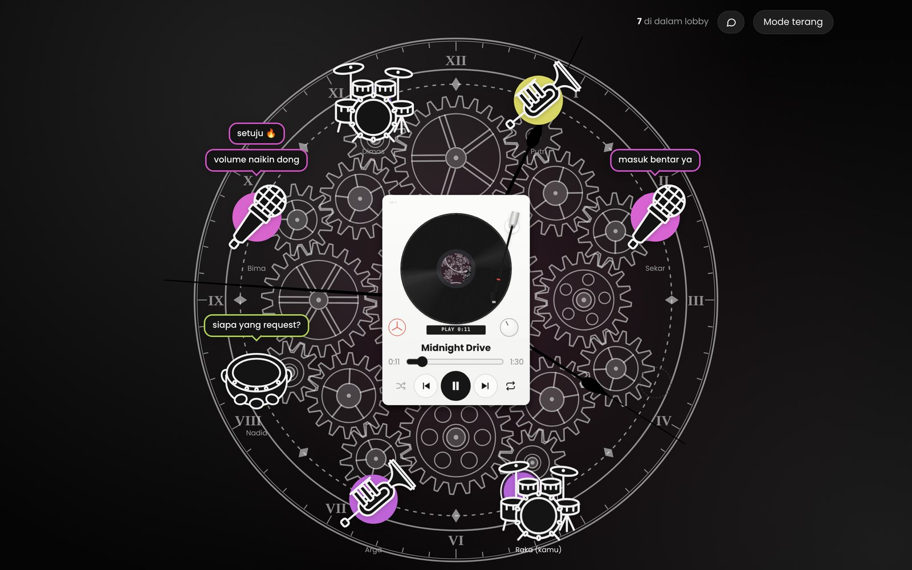

# 🎧 Xina Music

**Ruang dengar musik bersama secara realtime. Putar lagu barengan dan ngobrol lewat gelembung chat.**

## Tampilan

| Mode gelap | Tampilan HP |
|:--:|:--:|
|  |  |

## Fitur

- 🎶 **Putar bareng, sinkron.** Semua orang mendengar lagu yang sama di posisi yang sama.
- 📻 **Antrean bersama.** Siapa pun bisa menambah lagu. Play, pause, seek, next, prev, shuffle, dan loop berlaku untuk seluruh lobby.
- 👥 **Maksimal 8 orang.** Kalau penuh, pendengar berikutnya menunggu dan masuk otomatis saat ada kursi kosong.
- ⛵ **Kapal terbuka tiap lagu.** Lobby mulai polos (jam, kursi, pemutar ukuran penuh). Begitu lagu yang diputar mencapai 1 menit, dunia kapal terbuka dari gir tengah jam sampai menutupi layar: laut, kapal layar, dan camar. Jam, kursi, dan pemutar mengecil mulus ke tengah dek sampai muat di dalam lambung, tidak ada yang keluar. Zoom dengan scroll, cubit dua jari, atau tombol + / − di pojok kanan bawah; geser dengan menyeret laut atau dek kosong; tombol kompas atau tombol `0` mengembalikan kamera ke dek. Menjelang lagu habis (6 detik terakhir) atau saat lagu diganti, dunia menyusut kembali ke gir tengah dan lobby kembali ke ukuran penuh. Lagu yang lebih pendek dari sekitar 70 detik tidak membuka kapal.
- 🥁 **Alat musik ikut lagu.** Drum dipukul mengikuti bass dan snare, simbal bergoyang di hi-hat, tamborin bergetar sesuai treble. Mic, trumpet, ukulele, pianika, dan harmonika bergerak mengikuti vokal dan melodi.
- 🕰️ **Jam berdetak.** Saat tidak ada lagu, jam besar kembali ke waktu asli dan berbunyi tik-tok tiap detik. Volumenya mengikuti knob.
- 📝 **Catetan.** Tombol catetan di pojok atas untuk menulis teks singkat (maks 40 karakter). Tampil sebagai gelembung tetap di atas avatarmu, di bawah gelembung chat biasa, dan tidak hilang sampai kamu menyimpan catetan baru.
- ✉️ **Papan pesan.** Tombol amplop di pojok atas untuk meninggalkan pesan (maks 200 karakter) yang terbaca semua orang dan tidak hilang walau pengirimnya sudah keluar. Titik merah muncul di tombol saat ada pesan baru. Tiap orang hanya punya satu pesan: kirim lagi akan menimpa teks lamanya dan naik ke paling atas. Hanya 80 pesan terbaru yang disimpan, dan kamu bisa menghapus pesanmu sendiri. Aturan Firebase perlu diperbarui (ada `.indexOn` dan izin menimpa pesan sendiri). Contoh aturan Firebase ada di `docs/firebase-rules-messages.json` (gabungkan dengan rules yang sudah ada, jangan ditimpa).
- 🔔 **Notifikasi pesan baru (opsional).** Tombol di dalam papan pesan mengaktifkan Web Push: perangkat lain diberi tahu saat ada pesan baru, juga saat aplikasi ditutup. Butuh Worker (`worker.js`) dengan satu KV namespace bernama `PUSH_KV` (Worker > Settings > Bindings > Add > KV namespace). Kunci VAPID dibuat otomatis. Di iPhone hanya jalan kalau aplikasi di-install ke Home Screen (iOS 16.4+). Tanpa Worker/KV, tombolnya tidak muncul.
- 📲 **Bisa di-install** sebagai aplikasi (PWA) di komputer, Android, dan iPhone/iPad lewat tombol install di pojok atas. Cangkang aplikasi tetap terbuka walau offline, tapi lobby dan lagu bersama tetap butuh internet.
- 📴 **Offline.** Semua lagu lobby diunduh diam-diam ke perangkat (IndexedDB), jadi tetap bisa diputar sendiri tanpa internet, juga setelah aplikasi dibuka ulang. Saat internet kembali, aplikasi otomatis masuk lobby lagi dan ikut lagu serta posisi yang sedang diputar. Mode Hemat Data di browser menonaktifkan unduhan otomatis ini.
- 🌙 **AFK otomatis.** Kalau tab atau aplikasi disembunyikan (HP dikunci, pindah aplikasi) lagu tetap jalan di background dan avatarmu menampilkan catetan "AFK" sampai kamu kembali.
- ✏️ **Ganti nama** lewat ikon di samping tombol catetan.
- 💬 **Chat gelembung.** Pesan muncul di atas avatar, bertumpuk maksimal 3, dan hilang sendiri setelah 20 detik.
- 🗜️ **Lagu otomatis dikompres** saat diunggah, jadi lebih kecil dan hemat kuota.
- 💾 **Tersimpan di perangkat.** Lagu yang sudah didengar tidak diunduh ulang.
- 🛟 **Server cadangan otomatis.** Kalau server utama bermasalah, pindah sendiri ke cadangan.
- 🌗 **Mode terang dan gelap**, nyaman dipakai di HP maupun komputer.
- ⌨️ **Pintasan keyboard.** `Enter` untuk chat, `Spasi` untuk play/pause, `←` `→` untuk mundur/maju 5 detik.
