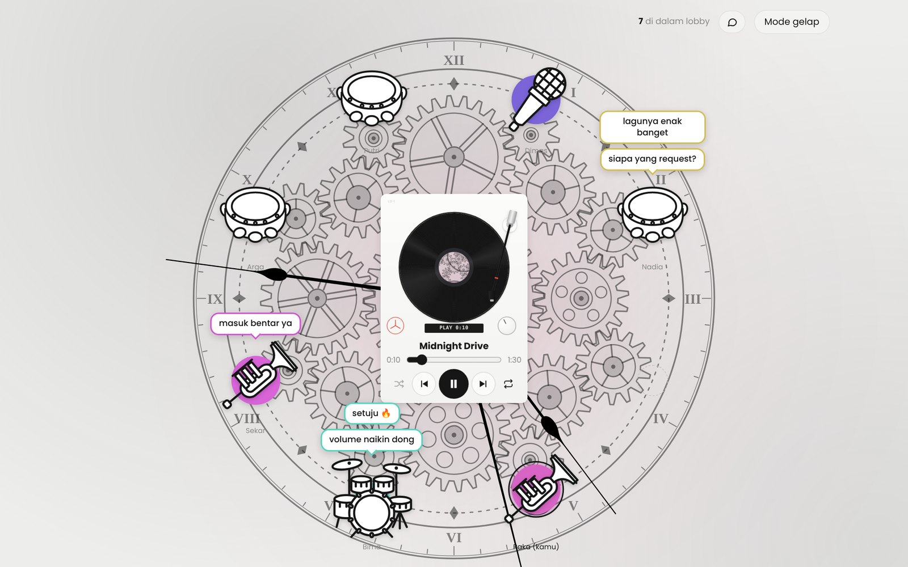
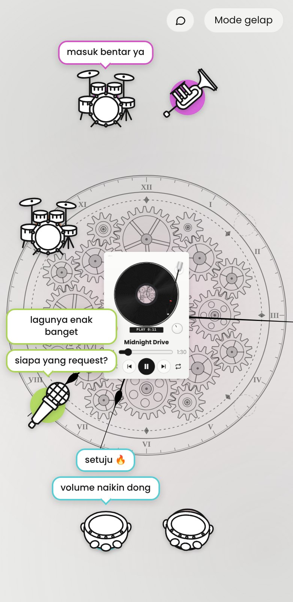

# 🎧 Lobby Dengar

**Ruang dengar musik bersama secara realtime. Putar lagu barengan dan ngobrol lewat gelembung chat.**

## Tampilan

| Mode gelap | Tampilan HP |
|:--:|:--:|
|  |  |

## Fitur

- 🎶 **Putar bareng, sinkron.** Semua orang mendengar lagu yang sama di posisi yang sama.
- 📻 **Antrean bersama.** Siapa pun bisa menambah lagu. Play, pause, seek, next, prev, shuffle, dan loop berlaku untuk seluruh lobby.
- 👥 **Maksimal 8 orang.** Kalau penuh, pendengar berikutnya menunggu dan masuk otomatis saat ada kursi kosong.
- 🥁 **Alat musik ikut lagu.** Drum dipukul mengikuti bass dan snare, simbal bergoyang di hi-hat, tamborin bergetar sesuai treble. Mic, trumpet, ukulele, pianika, dan harmonika bergerak mengikuti vokal dan melodi.
- 💬 **Chat gelembung.** Pesan muncul di atas avatar, bertumpuk maksimal 3, dan hilang sendiri setelah 10 detik.
- 🗜️ **Lagu otomatis dikompres** saat diunggah, jadi lebih kecil dan hemat kuota.
- 💾 **Tersimpan di perangkat.** Lagu yang sudah didengar tidak diunduh ulang.
- 🛟 **Server cadangan otomatis.** Kalau server utama bermasalah, pindah sendiri ke cadangan.
- 🌗 **Mode terang dan gelap**, nyaman dipakai di HP maupun komputer.
- ⌨️ **Pintasan keyboard.** `Enter` untuk chat, `Spasi` untuk play/pause, `←` `→` untuk mundur/maju 5 detik.
